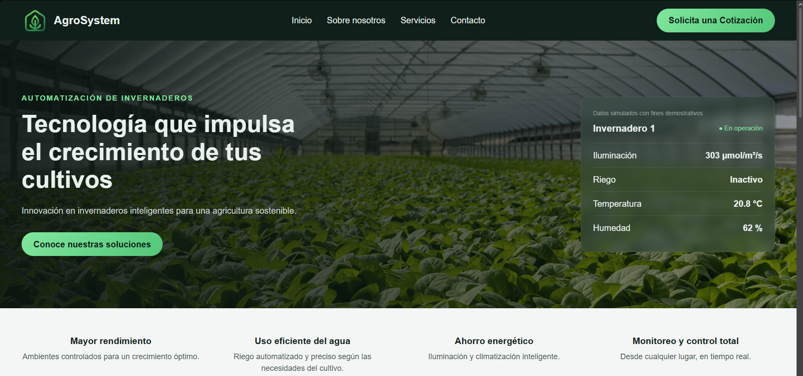

# AgroSystem - Web de automatización de invernaderos

Sitio web de un negocio **ficticio** que automatiza la iluminación y el riego de invernaderos. Es un proyecto de portafolio hecho con HTML, CSS y JavaScript, sin librerías externas.

**Ver el sitio en vivo:** [https://benjaleiva0807.github.io/Agrosystem-web-v2/](https://benjaleiva0807.github.io/Agrosystem-web-v2/)



## Características

- Página de una sola vista con menú de navegación por secciones
- Portada con foto de fondo y un panel de monitoreo llamado "Invernadero 1"
- Panel con datos **simulados** que se actualizan cada 2 segundos
- Control ON/OFF con histéresis para el riego: se enciende bajo el 60 % de humedad y se apaga sobre el 75 %
- Secciones de beneficios, sobre nosotros y tres tarjetas de soluciones (iluminación, riego y paneles de control)
- Formulario de contacto con validación en JavaScript (nombre, correo y mensaje) y mensaje de confirmación
- Paleta de verdes definida con variables CSS

## Tecnologías

- HTML5 con etiquetas semánticas
- CSS3 (variables, Flexbox y Grid)
- JavaScript sin librerías

## Cómo ejecutar

1. Descarga el repositorio
2. Abre `index.html` en el navegador (o usa la extensión Live Server de VS Code)

No es necesario instalar nada.

## Estructura del proyecto

```
index.html    estructura de la página
styles.css    estilos
script.js     panel simulado y validación del formulario
logo.png      logo
images/       fotos de la portada y de las tarjetas
```

## Qué aprendí

- Armar una página con etiquetas semánticas (header, nav, main, section y footer)
- Maquetar con Flexbox y Grid, y reutilizar colores con variables CSS
- Poner un degradado sobre una imagen de fondo para que el texto se lea bien
- Manipular la página con JavaScript: buscar elementos, cambiar su texto y ejecutar funciones cada cierto tiempo con setInterval
- Escuchar eventos y validar un formulario, incluyendo una expresión regular simple para el correo
- La lógica de un control ON/OFF con histéresis, el mismo principio de un termostato

## Limitaciones conocidas

- Los datos del panel son simulados: no hay sensores ni controlador real
- El formulario no envía información, solo valida y muestra un mensaje
- Todavía no está adaptada para celulares

## Posibles mejoras

- Diseño adaptable a celulares
- Cotizador con precio estimado según el servicio y la superficie
- Página aparte de panel de control con gráficos

## Créditos

- Fotografías: Unsplash y pexels
- AgroSystem, sus datos de contacto y su información son ficticios

## Otros proyectos

- [Calculadora Ley de Ohm v2 (Tkinter)](https://github.com/benjaleiva0807/Calculadora-ley-de-ohm-v2)
- [Calculadora Ley de Ohm v1 (consola)](https://github.com/benjaleiva0807/Calculadora)

## Autor

Benjamín Leiva - Estudiante de Ingeniería en Automatización y Control Industrial, y autodidacta de programación.